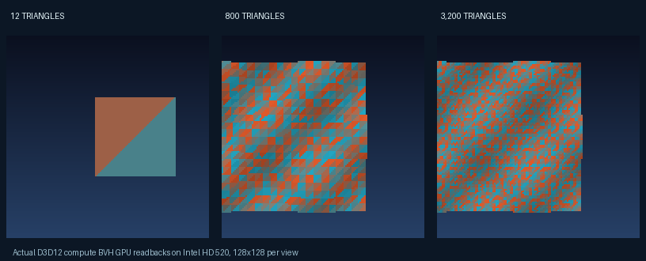

# Compatibility matrix: Intel HD Graphics 520

**GPU:** Intel HD Graphics 520 (VEN 8086, DEV 1916)
**Driver:** 22.20.16.4836 · **OS:** Windows 10 1903 (build 18362)
**Host:** WINDOWS_EXECUTION_HOST_02 · **CPU:** Intel i7-6500U

Only the integrated original Underdog rendering demo has passed a complete GPU-to-window test. No third-party game has been verified with the runtime yet.

| Game / fixture | Status | Native baseline | Underdog integration | Next test |
|---|---|---|---|---|
| Underdog Arena (original integration fixture) | compatible | not_applicable_original_underdog_game_demo | verified_runtime_bvh_gpu_swapchain | Independent manual camera playtest, additional mesh and 3200 triangle presentation fixture |
| Arcanum | in progress | historically_playable_clone | not_integrated | Identify owned clone renderer then add texture policy |
| Carmageddon (1997) via Dethrace | in progress | historically_raced_not_revalidated | not_integrated | Resolve Dethrace execution scope, inspect live SDL rendering interface, integrate Underdog as opt-in backend, then race/benchmark with owned game assets |
| Carmageddon TDR 2000 | in progress | historically_playable_or_demo | not_integrated | Independent baseline and owned adapter evaluation |
| Duke Nukem 3D Atomic | in progress | not_revalidated | not_integrated | Use supported source port to establish independent gameplay baseline |
| Far Cry (2004) | in progress | not_revalidated | not_integrated | Native baseline with safe process monitoring |
| Fortnite | in progress | driver_reset | not_integrated | Hold on game reinstrumentation until supported OS/driver test plan |
| Interstate '82 | in progress | historically_playable | not_integrated | Instrument stable graphics path in isolated fixture |
| Metal Gear Rising Revengeance | in progress | historically_playable | not_integrated | Native baseline measured separately from cooperative adapter |
| Quake (1996) | in progress | baseline_not_revalidated | not_integrated | Check an unprotected source port and its real render backend |
| Unreal Tournament 2004 | in progress | not_revalidated | not_integrated | Native baseline, supported renderer options, then integration |

## GPU image witness

The three images are actual 128x128 GPU readbacks, enlarged for inspection. None is a screenshot of a third-party game.

## Status rules

**Compatible:** A bounded playable or interactive slice using Underdog on the stated GPU, with repeatable evidence and no device removal. A rendering demo is not the same as a full game.
**In progress:** A native playable game with no Underdog adapter, missing benchmark, unverified configuration, or unresolved failure.
**Not feasible:** Only after a measured or technically demonstrated incompatibility for this particular GPU/driver/backend. This list currently has no entries in that category.

## Immediate next candidates

- **Underdog Arena:** Green for the original interactive renderer demo. The 12-, 800- and 3,200-triangle GPU BVH scenes all passed real swapchain presentation tests with scripted camera movement. Manual controller/gameplay features remain limited.
- **Quake 1:** Investigate a source-available renderer adapter. No Underdog code is integrated into Quake yet.
- **Carmageddon TDR 2000 / Interstate '82:** Investigate existing native rendering and compatibility paths first; standalone demos/earlier playability do not imply Underdog integration.
- **Fortnite:** Game process triggers Intel graphics driver resets on this OS/driver. No supported in-process adapter has been installed or tested.

See [machine-readable matrix](intel-hd-520.json) and the [original arena fixture](../docs/ARENA.md). This matrix must be updated after each hardware-specific verified test.
