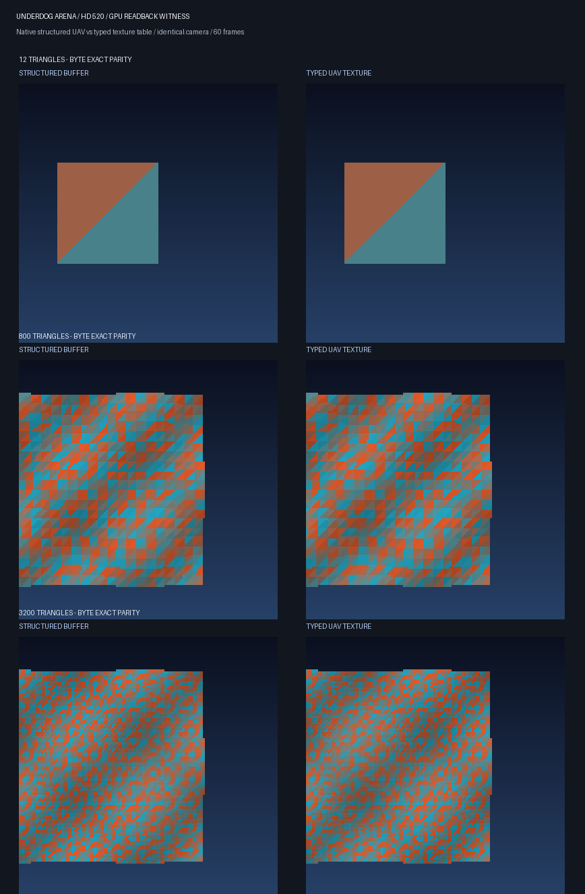

# UnderdogRuntime V07: WARP and native Arena typed texture backend

## Independent Microsoft WARP control

DXGI EnumWarpAdapter selected Microsoft WARP software adapter 1414:008C. We ran the 1-pixel D3D12 typed UAV root-versus-table matrix three times each for R32G32B32A32_FLOAT and R8G8B8A8_UNORM, for six accepted software-device matrices.

| UAV declaration | Root UAV descriptor | UAV descriptor table |
| --- | --- | --- |
| RWStructuredBuffer<float4> | PSO success; expected output | PSO success; expected output |
| RWTexture2D<float4> | PSO E_INVALIDARG, no GPU dispatch | PSO success; expected output |

Original-format RGBA8 pixel bytes: 64,128,191,255. No WARP device removal occurred. Independent hardware runs on HD 520 previously produced identical acceptance behavior.

These independent implementations make a D3D12 binding-contract mismatch the supported explanation for the minimal old Arena PSO error, not an Intel-specific defect. They do not explain Fortnite's unrelated GPU reset.

Sources: [Microsoft WARP](https://learn.microsoft.com/en-us/windows/win32/direct3darticles/directx-warp) and [Root descriptor restrictions](https://learn.microsoft.com/en-us/windows/win32/direct3d12/using-descriptors-directly-in-the-root-signature).

To reproduce, from the repository root:

    build/Release/underdog_typed_uav_ab.exe --warp
    build/Release/underdog_typed_uav_ab.exe --warp --rgba8

## Native Arena integration

The original standalone Arena V02 fixture remains independently buildable. A new original, owned Arena V03 variant runs the same BVH raytracing shader and 60-frame scripted camera, with an optional second GPU output backend:

- Default: RWStructuredBuffer packed-RGBA8 output via root UAV and buffer-to-backbuffer CopyTextureRegion
- Optional: RWTexture2D<float4> to a 128x128 RGBA8 UAV texture via shader-visible descriptor table, then a GPU texture-to-backbuffer copy

Both preserve native D3D12 submission, synchronization, GPU timestamp queries, DXGI Present, GPU image readback, and the original Intel HD 520 graphics environment. No CPU-rendered scene images are uploaded.

Examples (run from repository root):

    build/Release/underdog_arena_v03.exe 60 --autoplay fixtures/grid_800tri.obj
    build/Release/underdog_arena_v03.exe 60 --autoplay fixtures/grid_800tri.obj --typed-uav

The image witness is captured after the same final camera frame and validated by comparing all 49,152 RGB channel bytes. The visual evidence uses only output from our original 3D fixture.

## Hardware acceptance

V07 accepted 12 native HD 520 runs across three BVH geometries (12, 800 and 3,200 triangles), two output backends, and two repetitions per scene:

| Measured acceptance | Result |
| --- | --- |
| Swapchain Presents | 60 per run, all 12 accepted |
| Scripted camera actions | 60 per run |
| Paired GPU image witnesses | 6 of 6 byte-identical |
| Differing image channels | 0 |
| Device removal reasons | 0x00000000 |
| Texture preflight | Passed in all runs |

GPU P50/P95 and DXGI usage values are included in [the source-free matrix](../evidence/ARENA_TEXTURE_BACKEND_PARITY_V07.json). They show similar broad performance, but *not* a statistically isolated winner. Runs used separate windowed processes, VSync and shared desktop GPU activity.

## Resource-shape failure and regression safeguard

A first typed-texture Arena build mistakenly created a 128x1 texture, yet still created the PSO and presented 60 frames. The image witness was black. Correcting the texture to 128x128 restored the complete original image. This was a fixture bug, not evidence of an Intel driver defect.

UnderdogRuntime now includes a resource preflight in include/underdog/OutputResourcePolicy.h. It validates expected compute output dimensions, resource kind, UAV flags, sample count, format/layout, and packed-buffer byte capacity. Arena checks both its proposed description and the actual ID3D12Resource::GetDesc before submitting work. Hardware-free CTest includes the 128x1 negative control.

Sources: [D3D12_RESOURCE_DESC](https://learn.microsoft.com/en-us/windows/win32/api/d3d12/ns-d3d12-d3d12_resource_desc) and [CopyTextureRegion caveats](https://learn.microsoft.com/en-us/windows/win32/api/d3d12/nf-d3d12-id3d12graphicscommandlist-copytextureregion).

## Reproducibility and boundaries

- Separate local raw evidence: AIOS 06_EVIDENCE/UNDERDOG_WARP_UAV_BINDING_AB_V06.json and UNDERDOG_ARENA_TEXTURE_BACKEND_PREFLIGHT_V07.json
- Source-free public-to-repo summaries: evidence/WARP_TYPED_UAV_AB_V06.json and evidence/ARENA_TEXTURE_BACKEND_PARITY_V07.json
- Witness montage: evidence/ARENA_HD520_BACKEND_PARITY_V07.png
- Hosted Windows GitHub Actions compiles all code and runs hardware-free policy/evidence checks. The WARP and HD 520 live GPU replays must be performed on a Windows machine with the appropriate software/hardware adapter.
- Neither this proof nor the Intel static DDI pointer map establishes a Fortnite compatibility fix. No Intel display driver or protected process was modified.

Next candidate: an opt-in adapter to a source-available, legally acquired game, with a native baseline and an independently verified Underdog integration. Preserve original game asset provenance and do not promote to the compatibility matrix without actual in-game image, functionality and frame-time witnesses.
